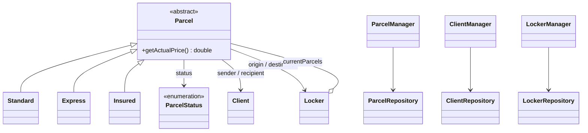

# Package Locker Management System 📦

A console application that simulates a parcel locker network: clients send parcels between lockers, and the system tracks every parcel from registration to collection.

Written in **C++23** with **CMake** as a team project (two people) for an Object-Oriented Programming course.

## Features

- **Clients** – register clients, look them up by e-mail or ID, filter them with predicates.
- **Lockers** – register lockers with a given capacity, check whether a locker is full, list the parcels it currently holds.
- **Parcels** – register, dispatch, collect by a courier, deliver to the destination locker and pick up. A parcel moves through the statuses `registered → dispatched → enRoute → deliveredToLocker → collected`.
- **Three parcel types** with polymorphic pricing (`getActualPrice()`):
  - `Standard` – base price,
  - `Express` – base price multiplied by a factor that depends on the deadline (`weekendDelivery`, `nextDay`, `sameDay`),
  - `Insured` – base price plus an insurance fee based on the declared value; can be marked as fragile and/or directional.
- **Persistence** – managers and repositories can save their data to a file.
- **Unit tests** for the business logic (see the `test/` directory).
- **API documentation** generated with Doxygen (`Doxyfile` included).

## Architecture

The code is split into three layers:

| Layer | Classes | Responsibility |
|---|---|---|
| Managers | `ClientManager`, `LockerManager`, `ParcelManager` | Business logic and use cases (registering, dispatching, delivering, collecting) |
| Repositories | `ClientRepository`, `LockerRepository`, `ParcelRepository` | Storing objects and searching them with `findBy(predicate)` / `findAllBy()` |
| Models | `Client`, `Locker`, `Parcel` (+ `Standard`, `Express`, `Insured`) | Data and behaviour of the domain objects |

Searching is parameterised with predicate objects (`ClientPredicate`, `LockerPredicate`, `ParcelPredicate`), so repositories stay independent from the concrete search criteria.



The complete UML class diagram is in [`diagram.puml`](diagram.puml) (PlantUML).

## Project structure

```
.
├── library/        # core logic: models, managers, repositories + unit tests
├── program/        # console interface, entry point (main.cpp)
├── diagram.puml    # UML class diagram (PlantUML)
├── Doxyfile        # Doxygen configuration
└── CMakeLists.txt
```

## Build and run

**Requirements:** CMake ≥ 3.10, a GCC toolchain with C++23 support, Boost (on macOS the CMake configuration expects it under Homebrew's `/opt/homebrew`).

```bash
git clone https://github.com/FilipKLGAOlczyk/package_locker_app.git
cd package_locker_app
cmake -S . -B build
cmake --build build
./build/program/<executable-name>
```

Run the tests:

```bash
ctest --test-dir build --output-on-failure
```

Generate the documentation:

```bash
doxygen Doxyfile
```

## Authors

Created by Filip Olczyk ([@FilipKLGAOlczyk](https://github.com/FilipKLGAOlczyk)) and a classmate.
